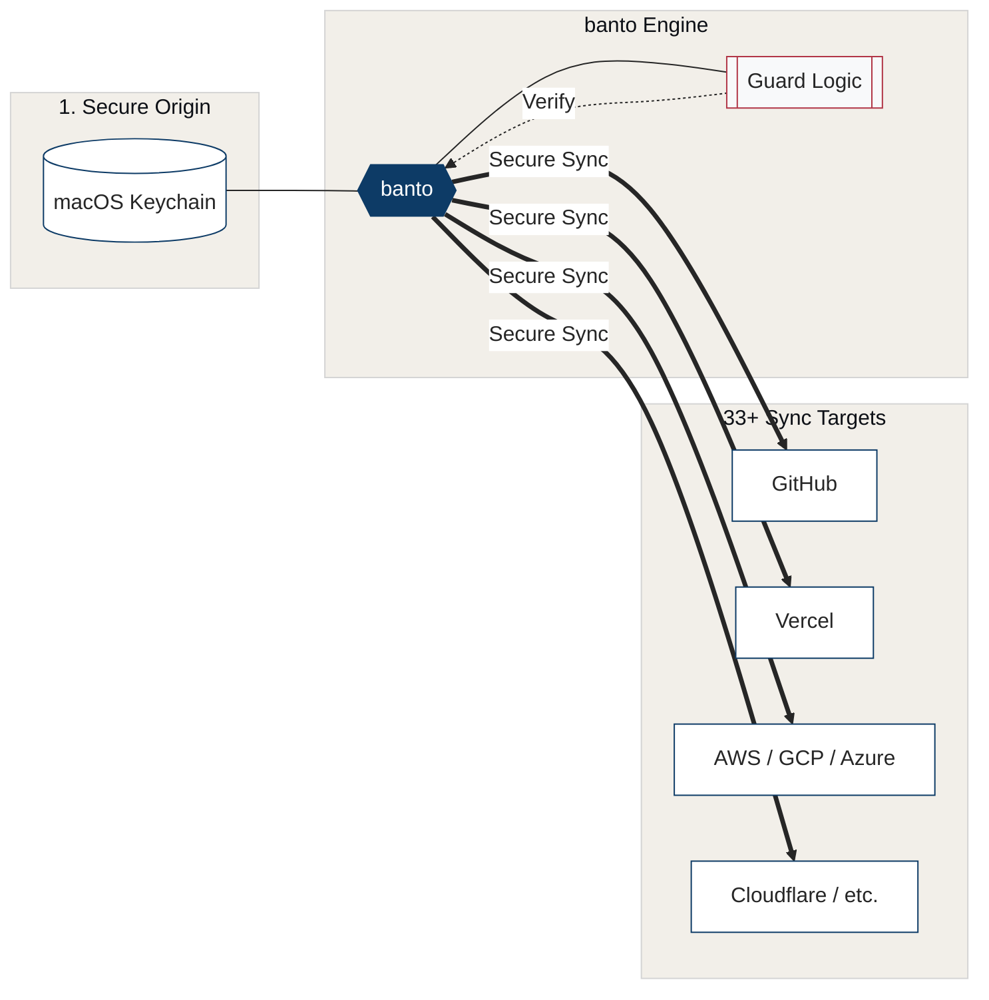

[English](./README.md)

<p align="center">
  
</p>

<p align="center">
  1コマンド。33プラットフォーム。必要な場所すべてに、あなたのシークレットを。
</p>

<p align="center">
  <a href="https://pypi.org/project/banto/"></a>
  
  
  
  <a href="https://github.com/allnew-llc/banto/actions/workflows/ci.yml"></a>
  
  
</p>

> **番頭**（banto） -- 江戸時代の商家において蔵の鍵と帳簿を預かり、主人の留守にも商いの秩序を守った筆頭番頭に由来します。

bantoはmacOS KeychainのAPIキーを33のクラウドプラットフォームに1コマンドで同期します。ダッシュボードにシークレットをコピペする作業はもう不要。AIエージェントに _「Vercelにシークレットをデプロイして」_ と伝えるだけ。エージェントがオーケストレーションし、bantoが同期し、シークレット値がチャットに入ることはありません。オプションの予算ゲーティングで、その上にインテリジェントなコスト制御を追加できます。

<p align="center">
  
</p>



## 目次

- [🔑 主な機能](#-主な機能)
- [🏮 なぜ banto？](#-なぜ-banto)
- [📋 動作要件](#-動作要件)
- [⚡ クイックスタート](#-クイックスタート)
- [💻 CLIリファレンス](#-cliリファレンス)
- [🤖 MCPサーバー](#-mcpサーバー)
- [🏠 ローカルブローカー](#-ローカルブローカーオプション)
- [🔒 セキュリティ](#-セキュリティ)
- [🐍 Python API](#-python-api)
- [🔌 カスタムバックエンド](#-カスタムバックエンド)
- [⚙️ 設定](#️-設定)
- [❓ よくある質問](#-よくある質問)
- [⚖️ 免責事項](#️-免責事項)
- [📄 ライセンス](#-ライセンス)

## 🔑 主な機能

- **33+ プラットフォーム同期** — 1コマンドで Vercel、Cloudflare、AWS、GCP、Azure、Kubernetes、GitHub Actions など 33 以上にシークレットをデプロイ。ダッシュボード操作不要
- **ワンコマンドセットアップ** — `banto sync setup vercel:my-project` でプラットフォームに環境変数名を問い合わせ、Keychainエントリとマッチングして設定。検出結果が空の場合は `--guess` で既知カタログにフォールバック
- **AIエージェント連携** — ClaudeやChatGPTに _「Vercelにシークレットを同期して」_ と指示するだけ。エージェントがオーケストレーションし、値はブラウザポップアップで入力。チャットに値が入ることはありません
- **プッシュ前検証** — 6つのプロバイダ（OpenAI、Anthropic、Gemini、GitHub、Cloudflare、xAI）に対してキーの有効性をチェックし、無効なキーの配信を防止
- **ドリフト検出** — SHA-256フィンガープリントでKeychainの変更を追跡。`banto sync audit` でデプロイ済みシークレットの陳腐化を検知
- **予算ガード** — オプションのホールド/精算パターンによるLLMコスト制御。予算なし=キーなし。グローバル、プロバイダ別、モデル別の上限設定
- **動的リース** — TTL付きの短期クレデンシャルを取得し、期限切れ時に自動失効
- **Webダッシュボード** — CSRF保護付きのlocalhost限定CRUDインターフェース（`banto sync ui`）
- **フィンガープリントドリフト検出** — SHA-256フィンガープリントでKeychainの変更と最終プッシュを追跡。`banto sync audit` でドリフトを検知
- **全コマンドで `--json` 出力** — エージェントやCI連携のための機械可読出力
- **通知連携** — Slack、Microsoft Teams、Datadog Events、PagerDuty
- **MCPサーバー** — Claude Code（stdio）とChatGPT Connector（トンネル経由HTTP/SSE）。14ツール（メタデータのみを返す同期・検証・リース系10個と、公開鍵・署名のみを返すsealed署名系4個）。ブローカーモードでは `banto_api_request` と `banto_broker_health` を加えた16ツール
- **ローカルブローカー（オプション、macOS）** — ユーザーごとの常駐プロセス1つだけがKeychainを読み、エージェントやスクリプトはUnix socket経由で操作を依頼します（値は返りません）。予算付き `api_request` はOpenAI/Anthropic呼び出し前に最大コストを予約し、報告された使用量で精算。分単位のレート制限と、メタデータのみのハッシュチェーン監査ログ
- **ランタイム依存ゼロ** — 標準ライブラリのみ（ctypesは標準ライブラリの一部）。MCPサーバーにはオプションの `mcp` パッケージが必要

<details>
<summary><strong>33プラットフォーム同期ドライバ</strong> — Cloudflare、Vercel、AWS、GCP、Azure、他28種</summary>

Cloudflare、Vercel、AWS、GCP、Azure、Kubernetes、Docker、Heroku、Fly.io、Netlify、Render、Railway、Supabase、GitLab、GitHub Actions、CircleCI、Bitbucket、Terraform Cloud、Azure DevOps、Deno Deploy、Hasura、Laravel Forge、DigitalOcean、Alibaba、Tencent、Huawei、Naver、NHN、JD Cloud、Sakura、Volcengineなど

</details>

## 🏮 なぜ banto？

多くのシークレット管理ツールでは、すべてのプラットフォームにシークレットを手動で設定する必要があります。bantoならAIエージェントに任せられます:

```
あなた:  「my-project の Vercel にシークレットを同期して」

エージェント: → banto_sync_setup(platform="vercel", project="my-project")
               ✓ 3件のキーがKeychainからマッチ
               ✗ 1件が未登録 — ブラウザを開きます
             → banto_register_key(provider="database")
               [ブラウザポップアップが開く — 値を入力]
             → banto_sync_push()
               4件のシークレットを Vercel にプッシュしました。

あなた:  完了。
```

**エージェントがオーケストレーション。人間が値を提供。シークレット値がチャットに入ることはありません。**

これが可能なのは、bantoのアーキテクチャが _何をするか_（エージェントが安全に扱えるメタデータ操作）と _実際のシークレット_（Keychainとブラウザポップアップのみ）を分離しているからです。

### ターミナル出力例: `sync setup`

```
$ banto sync setup vercel:my-project --dry-run

BANTO SYNC SETUP — vercel:my-project

  (dry run — no changes will be made)

  MATCH  OPENAI_API_KEY -> openai
  MATCH  ANTHROPIC_API_KEY -> anthropic
  MATCH  GITHUB_TOKEN -> claude-mcp-github
  MISS   DATABASE_URL (no Keychain match)

  Would register 3 secret(s). Remove --dry-run to apply.
```

> **注意:** `sync setup` はプラットフォームCLI（例: `vercel env ls --project <name>`）に環境変数名を問い合わせます。検出結果が空の場合（認証問題、プロジェクト名の誤り、空のプロジェクト）、コマンドは安全側に倒れて停止し、`--guess` による既知カタログへのフォールバックを提案します。

### ターミナル出力例: `sync validate`

```
$ banto sync validate --keychain

BANTO SYNC VALIDATE — Testing 4 key(s)

  PASS    openai: Key valid
  PASS    anthropic: Key valid
  UNKNOWN xai: Cannot verify (403)
  PASS    github: Token valid
```

## 📋 動作要件

- macOS（シークレット管理にKeychainを使用）
- Python 3.10+
- 外部依存なし（MCPサーバー: `pip install "banto[mcp]"`）

## ⚡ クイックスタート

### 1. インストール

```bash
# uv（推奨）
uv tool install banto

# pipx
pipx install banto

# pip
pip install banto

# MCPサーバーサポート付き
pip install "banto[mcp]"

# ソースからインストール
git clone https://github.com/allnew-llc/banto.git
cd banto
pip install -e .

# 最新の開発版（GitHub）
uv tool install "git+https://github.com/allnew-llc/banto.git"
pipx install "git+https://github.com/allnew-llc/banto.git"
pip install "git+https://github.com/allnew-llc/banto.git"
pip install "banto[mcp] @ git+https://github.com/allnew-llc/banto.git"
```

### 2. プラットフォームに同期 — 1コマンド

```bash
banto sync setup vercel:my-project   # プラットフォームに問い合わせ + Keychainマッチ
banto sync push                      # 全ターゲットにデプロイ
```

これだけ。bantoがプラットフォームから環境変数名を取得し、Keychainエントリとマッチングし、プッシュします。

またはAIエージェントに依頼:

> _「Vercel の my-project にシークレットを同期して」_

### 3. キーの登録（Keychainに未登録の場合）

```bash
banto register openai    # ブラウザポップアップが開く — そこでキーを入力
banto store openai       # またはターミナルのマスクプロンプトで入力
```

### 4. プッシュ前に検証

```bash
banto sync validate --keychain       # 全キーをプロバイダAPIでテスト
banto sync push --validate           # 検証 + プッシュを一括実行
```

### 5. （オプション）予算制御を追加

```bash
banto init                           # 予算設定ファイルを作成
banto budget 100                     # グローバル月次上限 $100
banto budget --provider openai 30    # OpenAI $30/月
```

## 💻 CLIリファレンス

<details>
<summary><strong>コアコマンド (13)</strong></summary>

| コマンド | 説明 |
|---------|------|
| `banto status` | 予算状況の表示（プロバイダ別・モデル別の内訳付き） |
| `banto budget [amount]` | 予算上限の表示・設定（グローバル、プロバイダ別、モデル別） |
| `banto profile [name]` | アクティブなモデルプロファイルの表示・設定（quality/balanced/budget） |
| `banto store <provider>` | APIキーをKeychainに登録（ターミナルプロンプト） |
| `banto register [provider]` | ブラウザポップアップを開いてAPIキーを登録 |
| `banto register-asc` | App Store Connect（.p8キー）登録ポップアップを開く |
| `banto delete <provider>` | APIキーをKeychainから削除 |
| `banto list` | 登録済みキー（`store`/`register` と同じKeychain名前空間）と予算の一覧 |
| `banto check <model> ...` | グローバル・プロバイダ別・モデル別上限に対するドライラン（`--tokens`、`--n`、`--seconds`、`--quality`、`--size`）。予算無効時は `ALLOWED (budget disabled)` |
| `banto init` | デフォルト設定を `~/.config/banto/` にコピー |
| `banto version` | インストール済みのバージョンを表示（`banto --version` / `banto -V` も可。ブローカーモードでも動作） |
| `banto sealed <cmd>` | Secure Enclave署名鍵: `create-key`、`export-pubkey`、`sign`、`verify`、`list`、`delete` |
| `banto broker <cmd>` | ローカルブローカー: `install`、`health`、`enable`、`disable`、`call`、`audit [--tail N] [--verify]`（[ローカルブローカー](#-ローカルブローカーオプション)参照） |

`banto profile <name>` の選択は `~/.config/banto/config.json` に保存されます。`banto status` は90日より古い料金エントリや、料金未登録のプロファイルモデルを警告します。`banto register-x-oauth` はありません。X OAuth 2.0ユーザートークンは `banto sync x-oauth-authorize` で登録します（このコマンドは案内を表示して終了コード2で終了します）。

</details>

<details>
<summary><strong>Syncコマンド (31)</strong></summary>

| コマンド | 説明 |
|---------|------|
| `banto sync setup <plat:proj>` | プラットフォームに環境変数を問い合わせ + Keychainマッチング（`--dry-run`、`--guess`） |
| `banto sync init` | デフォルトの `sync.json` を作成 |
| `banto sync status` | 同期ステータスマトリクス（シークレット x ターゲット） |
| `banto sync classify` | シークレットをローテーション戦略別に分類 |
| `banto sync incident-report` | インシデント対応向けに優先度を整理 |
| `banto sync vercel-inventory` | 値を読まずにVercel環境変数の棚卸しを実行 |
| `banto sync push [name]` | Keychainからターゲットにシークレットをプッシュ（`--validate` でプッシュ前チェック） |
| `banto sync add <name>` | 新規シークレットの追加（`--env`、`--target platform:project`） |
| `banto sync import-keychain <name>` | 既存のKeychain項目を値を表示せずにsyncアカウントへ取り込み |
| `banto sync google-api-key <name>` | Google APIキーを発行し、安全に伝播 |
| `banto sync openai-service-account <name>` | OpenAI service account keyを発行し、安全に伝播 |
| `banto sync openai-service-accounts` | キー値を出さずにOpenAI service accountを一覧 |
| `banto sync openai-revoke-service-account` | OpenAI service accountを失効 |
| `banto sync xai-api-key <name>` | management keyを使ってxAI runtime API keyを発行 |
| `banto sync x-oauth-authorize <name>` | PKCEで必要スコープだけのX OAuth 2.0ユーザートークンを登録（ローカルcallback、値は表示しない） |
| `banto sync x-oauth-user-token <name>` | refresh tokenでX OAuth 2.0ユーザートークンをローテーション |
| `banto sync browser-batch <plan.json>` | メタデータのみの計画ファイルで複数のブラウザローテーションを実行 |
| `banto sync browser-record <name>` | 管理画面の操作を値を書き込まずにbrowser recipeとして記録 |
| `banto sync browser-issue <name>` | ローカルブラウザrecipeでキーを発行し、値を表示せずKeychainと同期先へ反映 |
| `banto sync browser-revoke <name>` | 置換後、ブラウザ管理キーをkey id/ラベルで失効 |
| `banto sync cloudflare-account-token <name>` | Cloudflare Account API tokenを発行し、値を表示せず伝播 |
| `banto sync stripe-webhook-endpoint <name>` | Stripe webhook endpointを作成し、署名secretを伝播 |
| `banto sync propagate <name>` | 信頼済みローカルコマンドの置換値を保存・同期 |
| `banto sync rotate <name>` | シークレットの対話的ローテーション、または `--from-cli '<command>'` で自動化 |
| `banto sync audit` | ドリフト検出: 存在確認、フィンガープリント、ファイル不一致、陳腐化（`--max-age-days N`） |
| `banto sync validate` | プロバイダエンドポイントに対するキー検証（`--keychain`、`--dry-run`） |
| `banto sync history <name>` | フィンガープリント付きのバージョン履歴を表示 |
| `banto sync run [--env E] -- <cmd>` | シークレットを環境変数として注入してコマンドを実行 |
| `banto sync export` | シークレットをenv/json/docker形式でエクスポート（`--format`、`--env`） |
| `banto sync import <file>` | `.env` または `.json` ファイルからシークレットをインポート |
| `banto sync ui [--port N]` | localhost Webダッシュボードを起動（デフォルトポート 8384） |

</details>

<details>
<summary><strong>Leaseコマンド (5)</strong></summary>

| コマンド | 説明 |
|---------|------|
| `banto lease acquire <name>` | 短期クレデンシャルの取得（`--cmd`、`--revoke-cmd`、`--ttl`） |
| `banto lease get <lease_id>` | クレデンシャル値の取得（stdout、パイプ用）。秘密値を出力するため、エージェント環境では実行しない |
| `banto lease revoke <lease_id>` | リースの明示的な失効（失効コマンドが失敗した場合は終了コード1、状態は `revoke_failed`） |
| `banto lease list` | アクティブなリース、残りTTL、失効待ちリースの一覧 |
| `banto lease cleanup` | 期限切れリースの失効と、失敗した失効の再試行（失敗が残れば終了コード1） |

TTLは1秒〜7日です。`--revoke-cmd` では `$BANTO_LEASE_VALUE` を参照でき、値はargvではなく環境変数で渡されます（`/bin/sh -c` で実行）。失効に成功するまでリース値はKeychainに残ります。

</details>

<details>
<summary><strong>ChatGPTコマンド (1)</strong></summary>

| コマンド | 説明 |
|---------|------|
| `banto chatgpt connect` | MCP HTTPサーバー + トンネルを起動し、ChatGPT Connector URLを表示（`--ngrok` または `--cloudflared`） |

</details>

ブローカーモード（`banto broker enable`）では、`store`、`delete`、`lease`、および `status`・`audit`・`validate [--keychain]`・`push` 以外のsyncサブコマンドは無効です。`register`、`register-asc` と上記のsyncサブコマンドはブローカー経由で実行されます。

ほとんどのコマンドが `--json` オプションによる機械可読出力に対応しています。

## 🤖 MCPサーバー

bantoはMCPサーバーを公開し、AIエージェントがシークレット管理を行えるようにします。エージェントがシークレット値を受け取ることはありません — 同期・検証系ツールはメタデータのみを返し、sealed 署名系ツールは公開鍵または署名のみを返します（秘密鍵・シークレット値は返しません）。

### Claude Code

`.mcp.json` に以下を追加:

```json
{
  "mcpServers": {
    "banto": {
      "command": "banto-mcp",
      "args": []
    }
  }
}
```

オプションのMCP依存パッケージが必要です:

```bash
pip install "banto[mcp]"
```

### ChatGPT

```bash
banto chatgpt connect
```

MCPサーバーをHTTPモードで起動し、トンネル（ngrokまたはcloudflared）を開いて、ケイパビリティトークン付きのセキュアなConnector URLを表示します。このURLをChatGPTのConnector設定に貼り付けてください。

> **Developer Modeのみ。** bantoはローカルChatGPT Connectorとしての使用を想定しており、公開App Store提出は対象外です（OpenAIの提出ガイドラインはAPIキーの収集を禁止しています）。トンネルURLにはランダムトークンが含まれます — パスワードと同等に扱ってください。MCPリクエスト/レスポンストラフィックはトンネルプロバイダー（ngrokまたはCloudflare）を経由します。シークレット値はレスポンスに含まれませんが、メタデータ（シークレット名、同期状態）はトンネルを通過する場合があります。

### トランスポートモード

```bash
banto-mcp                              # stdio (Claude Code)
banto-mcp --transport sse --port 8385  # SSE (dev)
banto-mcp --transport http --port 8385 # HTTP (production / ChatGPT)
```

### 利用可能なツール

| ツール | 用途 | 備考 |
|--------|------|------|
| `banto_sync_status` | 同期マトリクスの表示（シークレット x ターゲット） | 読み取り専用 |
| `banto_sync_push` | クラウドターゲットへのシークレットプッシュ | クラウド状態を変更 |
| `banto_sync_audit` | ドリフトと陳腐化のチェック | 読み取り専用 |
| `banto_validate` | sync.json内のキー検証 | プロバイダAPIにキーを送信 |
| `banto_validate_keychain` | 全Keychainキーのスキャン + 検証 | プロバイダAPIにキーを送信 |
| `banto_budget_status` | 予算内訳の表示 | 読み取り専用 |
| `banto_register_key` | キー入力用ブラウザポップアップを起動 | 人間が値を入力 |
| `banto_lease_list` | アクティブなリースの一覧 | 読み取り専用 |
| `banto_lease_cleanup` | 期限切れリースの失効 | Keychainを変更 |
| `banto_sync_setup` | プラットフォームの環境変数を検出し Keychain と照合 | クラウドに問い合わせ |
| `banto_sealed_create_key` | Secure Enclave で保護された署名鍵を作成 | 秘密鍵はエンクレーブ外に出ません |
| `banto_sealed_export_pubkey` | sealed 鍵の公開鍵を出力 | 読み取り専用 |
| `banto_sealed_sign` | sealed 鍵でペイロードに署名 | user-presence 鍵では Touch ID / パスコード確認 |
| `banto_sealed_list` | sealed 鍵の一覧 | 読み取り専用 |
| `banto_api_request` | ブローカーモードのみ: キーを渡さずOpenAI Responses / Anthropic Messagesを呼び出し | API利用料が発生。予算・レート制限・監査対象 |
| `banto_broker_health` | ブローカーモードのみ: ブローカーの稼働確認 | 読み取り専用。Keychainを読まない |

すべてのツールにOpenAI互換アノテーション（`readOnlyHint`、`destructiveHint`、`openWorldHint`）が含まれます。

## 🏠 ローカルブローカー（オプション）

ブローカーはユーザーごとのLaunchAgent（`work.allnew.banto.broker`）で、Keychainを読む唯一のプロセスです。MCPクライアント（`banto-mcp` は自動で転送）、CLI、Pythonスクリプト（`banto.broker_client.BrokerClient`）はUnix socket（0700ディレクトリ内の0600、接続元UIDを検証）で操作を依頼します。秘密値を返す操作はありません。

```bash
uv tool install "banto[mcp]"     # pipx / pip でも可。ブローカーには mcp extra が必要
banto broker install             # このPythonの絶対パスでLaunchAgentを登録
banto broker health              # PIDとPythonパスのみ。Keychainは読まない
banto broker enable              # ブローカーモード: 直接Keychainを読む経路は失敗する
banto broker audit --verify      # ハッシュチェーン監査ログを検証
```

banto更新後はサービスを再起動します: `launchctl kickstart -k gui/$(id -u)/work.allnew.banto.broker`。`banto broker disable` で従来モードに戻ります。詳細: [docs/local-broker.md](./docs/local-broker.md)。

**`api_request`**（`BrokerClient().call("api_request", provider="openai"|"anthropic", payload={...})` またはMCPの `banto_api_request`）はOpenAI Responses / Anthropic Messagesの非ストリーミング呼び出しです。宛先・認証ヘッダー・リダイレクトは固定で、リモートツールやストリーミングは拒否します。予算ゲーティングが有効な場合:

- payloadに `max_output_tokens`（OpenAI）/ `max_tokens`（Anthropic）が必要で、モデルは `pricing.json` に `per_token` エントリが必要です（なければ `unpriced_model`）
- 呼び出し前に最大コスト（payloadサイズを入力トークンの上限とみなす + 最大出力）を永続holdとして予約し（収まらなければ `budget_exceeded`）、プロバイダが報告した使用量で精算します（レスポンスの `banto_budget`）
- 4xxで拒否された場合はholdを解放します。ネットワークエラー・タイムアウト・5xxは課金された可能性があるためholdを残します（`upstream_failed_or_outcome_unknown`）。残したholdは `hold_timeout_hours` では解除されず、その月の予算に計上されます

呼び出しは `broker.api_request_rpm`（1分あたり、既定30、`0`で無効）に制限されます。すべての操作はブローカーのruntimeディレクトリの `audit.jsonl` に記録されます。内容は時刻、操作、結果、エラーコード、許可リストのメタデータ（プロバイダ、モデル、ステータス、コスト、トークン数、引数名）のみで、payloadや値は含みません。各レコードは直前レコードのSHA-256を持ちます。

## 🔒 セキュリティ

- **ctypes Keychainアクセス** — `store()` と `get()` はmacOS Security frameworkを直接呼び出します（SecKeychainAddGenericPassword / SecKeychainFindGenericPassword）。subprocess不使用、argv露出なし
- **stdin経由のsyncドライバ** — 33のドライバすべてがstdinパイプ、tempfile（0600）、または `curl -K -` / `-d @file` でシークレットを渡します。シークレット値がプロセス引数に現れることはありません
- **Web UIのCSRF保護** — セッションごとのトークンがすべてのPOSTエンドポイントで必須、Originヘッダー検証、Content-Type強制
- **ChatGPT用ケイパビリティURL** — `banto chatgpt connect` がランダムなパストークンを生成。URLがベアラクレデンシャルとなります
- **フェイルクローズド履歴** — Keychainへの書き込みが失敗した場合、`record()` は `None` を返します。壊れたバージョンのメタデータは保存されません
- **ブラウザ登録ポップアップ** — localhost限定（127.0.0.1）、ランダムポート、使い捨て。値がエコーバックされることはありません
- **検証はopt-in** — `banto sync validate --keychain` には明示的なフラグが必要。`--dry-run` も利用可能
- **リースクレデンシャルの分離** — リース値はKeychainに保持。`lease-state.json` にはメタデータのみ

### 脅威モデル

bantoはプロセス引数や標準ログへのシークレット露出を防止します。以下に対しては防御**しません**:

- **無制限シェルアクセスを持つエージェント** — `security` CLI で直接 Keychain を問い合わせ可能
- **カーネルレベルの検査** — OS 監査サブシステムやファイルシステムレベルのアクセスは tempfile 削除前に観測可能
- **トンネルプロバイダーの可視性** — `banto chatgpt connect` はメタデータ（シークレット名、同期状態）を ngrok / Cloudflare 経由でルーティング

多層防御として: エージェントランタイム側でシェルアクセスを制限し、センシティブな環境では OS レベルのアクセス制御も検討してください。

`sync export` と `sync run` は相互運用のため意図的にシークレットを環境変数やstdoutに出力します。エージェントコンテキストではこれらを使用しないでください。

## 🐍 Python API

### 予算ゲーティングあり

```python
from banto import SecureVault, BudgetExceededError, KeyNotFoundError

vault = SecureVault(caller="my_app", budget=True)

try:
    key = vault.get_key(
        model="gpt-4o",
        input_tokens=1000,
        output_tokens=500,
    )
    response = openai.chat.completions.create(
        model="gpt-4o",
        messages=[...],
        api_key=key,
    )
    vault.record_usage(
        model="gpt-4o",
        input_tokens=response.usage.prompt_tokens,
        output_tokens=response.usage.completion_tokens,
        provider="openai",
        operation="chat",
    )
except BudgetExceededError as e:
    print(f"予算超過: 残り${e.remaining:.2f} / 上限${e.limit:.2f}")
except KeyNotFoundError as e:
    print(f"キー未登録: banto store {e.provider}")
```

### 予算なし（キー管理 + 同期のみ）

```python
from banto import SecureVault

vault = SecureVault(caller="my_app", budget=False)
key = vault.get_key(provider="openai")
# キーを直接使用 — コスト追跡なし
```

### 自動検出モード（デフォルト）

```python
vault = SecureVault(caller="my_app")
# budget=None: 設定から自動検出
# monthly_limit_usd > 0 の場合は有効、それ以外は無効
```

### CostGuard（シークレットストレージなしの予算追跡）

```python
from banto import CostGuard

guard = CostGuard(caller="my_mcp")
hold_id = guard.hold_budget(model="dall-e-3", provider="openai",
                            n=1, quality="standard", size="1024x1024")
# ... APIコール ...
guard.settle_hold(hold_id, model="dall-e-3", n=1, provider="openai", operation="image")
```

## 🔌 カスタムバックエンド

シークレットの保管先は `SecretBackend` プロトコルにより差し替え可能です。`get`、`store`、`delete`、`exists`、`list_providers` メソッドを持つ任意のオブジェクトが使用できます。継承は不要です。

### 環境変数

```python
import os
from banto import SecureVault

class EnvVarBackend:
    """BANTO_KEY_<PROVIDER> 環境変数からAPIキーを読み取る。"""

    def get(self, provider: str) -> str | None:
        return os.environ.get(f"BANTO_KEY_{provider.upper()}")

    def store(self, provider: str, api_key: str) -> bool:
        os.environ[f"BANTO_KEY_{provider.upper()}"] = api_key
        return True

    def delete(self, provider: str) -> bool:
        return os.environ.pop(f"BANTO_KEY_{provider.upper()}", None) is not None

    def exists(self, provider: str) -> bool:
        return f"BANTO_KEY_{provider.upper()}" in os.environ

    def list_providers(self, known_providers: list[str]) -> list[str]:
        return [p for p in known_providers if self.exists(p)]

vault = SecureVault(caller="my_app", backend=EnvVarBackend())
```

### 1Password CLI

```python
import json
import subprocess
from banto import SecureVault

class OnePasswordBackend:
    """1Password CLI (op) を使用してAPIキーを取得する。"""

    def __init__(self, vault_name: str = "Private"):
        self.vault_name = vault_name

    def get(self, provider: str) -> str | None:
        try:
            result = subprocess.run(
                ["op", "item", "get", f"banto-{provider}",
                 "--vault", self.vault_name,
                 "--fields", "label=credential", "--format", "json"],
                capture_output=True, text=True,
            )
            if result.returncode == 0:
                return json.loads(result.stdout).get("value")
        except (subprocess.SubprocessError, OSError):
            pass
        return None

    def store(self, provider: str, api_key: str) -> bool: ...
    def delete(self, provider: str) -> bool: ...
    def exists(self, provider: str) -> bool:
        return self.get(provider) is not None
    def list_providers(self, known_providers: list[str]) -> list[str]:
        return [p for p in known_providers if self.exists(p)]

vault = SecureVault(caller="my_app", backend=OnePasswordBackend())
```

### インメモリ（テスト用）

```python
from banto import SecureVault

class InMemoryBackend:
    def __init__(self, keys: dict[str, str] | None = None):
        self._store = dict(keys) if keys else {}

    def get(self, provider: str) -> str | None:
        return self._store.get(provider)
    def store(self, provider: str, api_key: str) -> bool:
        self._store[provider] = api_key
        return True
    def delete(self, provider: str) -> bool:
        return self._store.pop(provider, None) is not None
    def exists(self, provider: str) -> bool:
        return provider in self._store
    def list_providers(self, known_providers: list[str]) -> list[str]:
        return [p for p in known_providers if p in self._store]

vault = SecureVault(
    caller="test",
    backend=InMemoryBackend({"openai": "test-key-12345"}),
)
```

完全な実装例は [examples/06_custom_backend.py](./examples/06_custom_backend.py) を参照してください。

## ⚙️ 設定

すべての設定ファイルは `~/.config/banto/` に配置されます。`banto init` でデフォルトが作成されます。

### `config.json` — 予算とプロバイダ設定

```json
{
  "monthly_limit_usd": 0,
  "broker": {"api_request_rpm": 30},
  "providers": {
    "openai": {
      "models": ["gpt-4o", "dall-e-3", "sora-2"]
    },
    "google": {
      "models": ["gemini-3-pro-image-preview", "imagen-4.0-generate-001"]
    }
  }
}
```

予算はUSD建てで、暦月単位で適用されます。デフォルトは `0`（予算無効。コストチェックなしでキーが返されます）。値を設定すると予算ゲーティングが有効になります。`banto budget` / `CostGuard.set_budget()` は `~/.config/banto/config.json`（初回書き込み時に同梱の既定値から作成）に書き込み、インストール済みパッケージ内のファイルは変更しません。`broker.api_request_rpm` はブローカーの `api_request` の1分あたりの上限です。

### `pricing.json` — モデル料金テーブル

```json
{
  "_updated": "2026-10-17",
  "gpt-4o": {
    "type": "per_token",
    "input_per_1k": 0.0025,
    "output_per_1k": 0.01,
    "verified": "2026-10-17"
  },
  "dall-e-3": {
    "type": "per_image",
    "variants": {
      "standard_1024x1024": 0.040,
      "hd_1024x1024": 0.080
    },
    "fallback": 0.120
  },
  "sora-2": {
    "type": "per_second",
    "rate": 0.10
  }
}
```

料金は静的です。bantoは実行時にプロバイダAPIから料金を取得しません。各プロバイダの公式料金ページで最新の料金を確認し、`pricing.json` を更新してください。`verified` は各エントリを最後に確認した日付です（ない場合は `_updated`）。`banto status` は90日より古いエントリを警告します。

### `sync.json` — マルチプラットフォーム同期設定

```json
{
  "version": 1,
  "keychain_service": "my-vault",
  "secrets": {},
  "environments": {
    "dev": {},
    "prd": { "inherits": "dev" }
  }
}
```

`banto sync init` で作成されます。メタデータのみを含み、シークレット値は含まれません。

## ❓ よくある質問

<details>
<summary><strong>予算を超過した場合はどうなりますか？</strong></summary>

`get_key()` が `BudgetExceededError` を発生させ、APIキーは返されません。bantoのAPI経由ではキーを取得する方法がありません。例外には `remaining`（残額）と `limit`（上限）が含まれます。

</details>

<details>
<summary><strong>pricing.json はどのくらいの頻度で更新すべきですか？</strong></summary>

月1回、プロバイダの料金ページを確認してください。`verified` の日付が90日を超えると `banto status` が警告します。bantoは実行時に料金を取得しません（主要プロバイダには公開料金APIがありません）。料金が変更された場合は `~/.config/banto/pricing.json` を編集してください。

</details>

<details>
<summary><strong>record_usage() を呼ぶ前にエージェントがクラッシュした場合は？</strong></summary>

ホールドは予約されたままです。これは設計上の意図です（安全側バイアス）。ホールド額は月がリセットされるか、ホールドがタイムアウト（デフォルト: 24時間、`hold_timeout_hours`）するまで予算に計上され続けます。

</details>

<details>
<summary><strong>エージェントがbantoを迂回してKeychainを直接読めますか？</strong></summary>

はい、直接シェルアクセスがある場合は可能です。bantoは `get_key()` のみを使用するエージェントに対して有効です。多層防御のため、エージェントランタイム側でシェルアクセスを制限することを推奨します。

</details>

<details>
<summary><strong>LinuxやWindowsで使えますか？</strong></summary>

現時点では未対応です。bantoはmacOS Keychain（Security.framework via ctypes）を使用しています。`SecretBackend` プロトコルにより `libsecret`（Linux）や DPAPI（Windows）バックエンドの追加は可能ですが、未実装です。

</details>

<details>
<summary><strong>予算ゲーティングなしで使えますか？</strong></summary>

はい。`SecureVault(budget=False)` でコストチェックなしにキーを直接取得できます。v4.0.0 以降、予算はオプトインです。

</details>

<details>
<summary><strong>パフォーマンスへの影響は？</strong></summary>

無視できるレベルです。bantoは完全にローカルで動作します — ctypes経由のKeychainアクセスはサブミリ秒、予算チェックはローカルJSONファイルの `fcntl` ロック付き読み取り、syncドライバはプラットフォームCLIを直接呼び出します。リモートプロキシやネットワーク遅延はありません。ブローカーなしではプロセス内で動作し、オプションの[ローカルブローカー](#-ローカルブローカーオプション)を有効にした場合はローカルUnix socket経由でユーザーごとの常駐プロセスに依頼します。

</details>

## ⚖️ 免責事項

bantoは予算管理を支援するツールであり、API利用料金の超過を防止することを保証するものではありません。料金テーブルの不正確さ、ソフトウェアの不具合、設定の誤り、bantoのAPIを迂回するエージェントに起因する金銭的損害について、作者は一切の責任を負いません。利用者は、各プロバイダの課金ダッシュボードで実際のAPI利用料金を監視し、料金テーブルを最新の状態に維持する責任を負います。

## 📄 ライセンス

デュアルライセンス:

- **個人利用**（無料）: 個人の方は、個人・教育・研究目的で無償で利用・改変・再配布できます。
- **商用利用**（有料）: 企業・組織での利用には、[AllNew LLC](https://github.com/allnew-llc/banto/issues) との商用ライセンス契約が必要です。

詳細は [LICENSE](./LICENSE) をご参照ください。

## 共通 core の開発

broker の共通部品は [`core/`](core/README.md) にあります。この checkout では
`pip install ./core .` または `uv sync` でローカルの core と本体を導入します。
core に依存する Banto を配布する前に、承認された core を先に配布してください。
ソースの変更だけでは、導入済みクライアントや LaunchAgent は更新されません。
